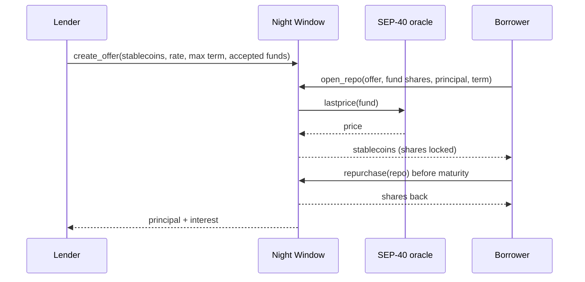

# Night Window

[](https://github.com/EricLtx/hackmeridian-2026/actions/workflows/ci.yml)
[](LICENSE)
[](https://developers.stellar.org/docs/build/smart-contracts)

An on-chain repo contract on Stellar. Holders of tokenized money market funds borrow stablecoins against their shares at any hour, for a fixed term and a fixed price, when the fund's redemption window is closed.

> **Status:** early development, specification being refined (October 2026). The contract is scaffolded and tested (administration, fund registry, upgrade path, SEP-40 price lookup); the repo lifecycle itself is declared and waits for the specification. Nothing is deployed on mainnet. "Night Window" (French: *guichet de nuit*) is a working name.

## Why

- **Tokenized money market funds settle once per business day.** Between two redemption windows, a holder who needs liquidity cannot sell. Over a weekend the wait is three days.
- **So holders keep a buffer of idle stablecoins** next to their fund shares, and that buffer earns nothing.
- **A repo closes the gap.** The holder locks shares, receives stablecoins in the same transaction, and gets the shares back at a price fixed in advance. Lenders earn short-term interest secured by fund shares. Offers can come from the market, or from the fund issuer itself when it wants to back the liquidity of its own shares without building a dedicated facility.

Two parties, a fixed term, a known price, and you get your shares back. Banks do this every night; Night Window does it on a public payment network, with offers deposited in advance by whoever wants to lend.

## How it works

| Step | Who | What happens |
|---|---|---|
| Offer | Lender | Deposits stablecoins with terms: rate, maximum term, accepted funds |
| Open | Borrower | Locks fund shares and receives stablecoins in the same transaction |
| Repurchase | Borrower | Repays principal plus interest and gets the shares back |
| Default | Lender | After maturity, seizes the shares |
| Withdraw | Lender | Takes back the stablecoins that were not lent |



## Design choices

- Fixed term of seven days at most and a fixed rate. Early repurchase is allowed, with interest pro rata.
- A haircut per fund caps the loan below the value of the shares.
- Fund shares and stablecoins are SEP-41 tokens. The share price comes from a SEP-40 oracle chosen by the administrator.
- One ledger entry per fund, per offer and per repo, and no loop over all positions: the cost of every operation stays constant whatever the number of open repos.
- Issuer-agnostic: any permissioned fund share can be registered with its own oracle, haircut and allowlist. The contract address itself has to be allowlisted by the issuer, like any other holder, and so do lenders and borrowers.
- The share price comes from a NAV-based feed and is checked against an absolute band per fund, not a relative deviation from the previous reading: a money market fund share barely moves in a week, so a large jump is a faulty price, not a market move.
- An administrator keeps the registry of accepted funds and can upgrade the code. Error codes and exported types are append-only.
- Planned controls, documented in [docs/securite.md](docs/securite.md): an allowlist of accepted stablecoins, an emergency pause that blocks new offers and new repos but never repurchase, withdrawal or seizure, and an administrator held by a multisig with a time delay on upgrades and oracle changes.

## Contract interface

The contract lives in `contracts/night-window/src/lib.rs`; its tests in `src/test.rs`.

| Function | Who | Status |
|---|---|---|
| `__constructor(admin)` | deployer | done |
| `version()`, `admin()`, `set_admin(new_admin)`, `upgrade(new_wasm_hash)` | admin | done |
| `max_term()`, `set_max_term(seconds)` | admin | done, default 7 days |
| `set_fund(fund, config)`, `remove_fund(fund)`, `get_fund(fund)` | admin | done; `config` = SEP-40 oracle, oracle asset, haircut in basis points |
| `fund_price(fund)` | anyone | done; reads `lastprice` on the fund's SEP-40 oracle, no staleness check yet |
| `create_offer(lender, stablecoin, amount, rate_bps, max_term, funds)` | lender | declared, returns `NotImplemented` |
| `withdraw_offer(offer_id, amount)` | lender | declared, returns `NotImplemented` |
| `open_repo(borrower, offer_id, fund, shares, principal, term)` | borrower | declared, returns `NotImplemented` |
| `repurchase(repo_id)` | borrower | declared, returns `NotImplemented` |
| `seize(repo_id)` | lender | declared, returns `NotImplemented` |
| `get_offer(offer_id)`, `get_repo(repo_id)` | anyone | done |

The specification still has to settle: the price staleness window, the interest formula for early repurchase, loan sizing from price, haircut and token decimals, and what the lender may do with seized shares.

## Roadmap

- [x] Rust workspace, pinned toolchain, CI with security lints and dependency audit
- [x] Administration, upgrade path, fund registry, SEP-40 price lookup, tests
- [ ] Specification of the repo lifecycle
- [ ] Lifecycle: offers, open, repurchase, seize, withdraw, with property tests on the invariants
- [ ] STRIDE threat model and on-chain monitoring plan
- [ ] Multisig administrator, time delay on upgrades and oracle changes, emergency pause
- [ ] Testnet deployment with test fund tokens and a test oracle
- [ ] Minimal web interface
- [ ] Third-party audit before any mainnet deployment

## Security

[docs/securite.md](docs/securite.md) (French) holds the threat model, the contract invariants, the vulnerability classes mapped to this contract, the controls already in place and the decisions taken for the specification (price freshness and absolute price band per fund, MiCA-only stablecoin allowlist, emergency pause limited to new entries, multisig administrator with a time delay, launch caps, first-loss buffer). [docs/modele-menace-stride.md](docs/modele-menace-stride.md) (French) is the STRIDE threat model with a first monitoring plan. [SECURITY.md](SECURITY.md) says how to report a vulnerability.

The enforced part of the baseline:

- `rust-toolchain.toml` pins Rust 1.98.1 with the `wasm32v1-none` target, `rustfmt` and `clippy`.
- Workspace lints deny `unsafe_code`, unchecked arithmetic (`clippy::arithmetic_side_effects`), `unwrap`, `expect`, `panic!` and slice indexing in contract code. Tests opt out explicitly.
- Overflow checks stay on in release and test profiles.
- CI runs `cargo fmt --check`, `cargo clippy --all-targets -D warnings`, `cargo test`, `stellar contract build` and a RustSec advisory check on `Cargo.lock`. Every third-party action is pinned to a commit SHA and kept current by Dependabot. `make lint`, `make audit` and `make scout` in `contracts/night-window/` reproduce the checks locally.
- Maintenance rule: the workspace stays within the two latest major versions of `soroban-sdk`, the ones that receive security fixes, and is rebuilt and retested at every Stellar protocol upgrade. Deadlines are stored as timestamps, never derived from storage TTLs, so changes in ledger timing do not affect them.

## Repository layout

```
.
├── contracts/
│   └── night-window/        # the repo contract (src/lib.rs) and its host-side tests (src/test.rs)
├── docs/
│   ├── securite.md          # security baseline: threat model, invariants, framing decisions S1-S19 (French)
│   ├── modele-menace-stride.md # STRIDE threat model and first monitoring plan (French)
│   ├── stellar-platform.md  # overview of the Stellar platform (French)
│   └── claude-tooling.md    # AI tooling: plugins, skills, MCP (French)
├── .github/
│   ├── workflows/ci.yml     # format, lint, test, WASM build, RustSec audit
│   └── dependabot.yml       # weekly bumps of pinned actions and crates
├── .claude/settings.json    # Stellar plugin shared through the repo
├── .mcp.json                # Raven MCP server (Stellar docs and live data)
├── AGENTS.md / CLAUDE.md    # instructions for AI agents
├── rust-toolchain.toml      # pinned Rust version, target and components
├── SECURITY.md              # how to report a vulnerability
└── Cargo.toml               # Rust workspace (soroban-sdk 28) and security lints
```

The market study, the business proposal and third-party reference material are working documents kept outside the public repository (`private/` and `references/`, both git-ignored).

## Build and test

### 1. Tools

| Tool | Windows | macOS / Linux |
|---|---|---|
| Rust via rustup | [rustup.rs](https://rustup.rs) | `curl https://sh.rustup.rs -sSf \| sh` |
| Pinned toolchain and Wasm target | installed automatically by rustup from `rust-toolchain.toml` on the first `cargo` command | same |
| Stellar CLI | `winget install --id Stellar.StellarCLI` | `brew install stellar-cli` |

Check with `stellar --version`. The workspace is tested with 28.1.0.

### 2. Compile and test

```sh
cargo test                                      # unit tests, run off-chain
cargo clippy --all-targets -- -D warnings       # security lints
stellar contract build                          # → target/wasm32v1-none/release/night_window.wasm
```

### 3. Deploy to testnet

```sh
# Identity funded automatically by Friendbot
stellar keys generate alice --network testnet --fund

# The constructor takes the administrator address
stellar contract deploy \
  --wasm target/wasm32v1-none/release/night_window.wasm \
  --source-account alice --network testnet --alias night_window \
  -- --admin alice

stellar contract invoke --id night_window --source-account alice --network testnet \
  -- version
# 1
```

The deployed contract can be inspected on [stellar.expert/explorer/testnet](https://stellar.expert/explorer/testnet) or in [Stellar Lab](https://lab.stellar.org). `stellar contract invoke --id night_window -- -h` prints the generated command line for every function.

## Documentation

- [docs/securite.md](docs/securite.md): security baseline, threat model and invariants of the contract (French).
- [docs/modele-menace-stride.md](docs/modele-menace-stride.md): STRIDE threat model and monitoring plan (French).
- [docs/stellar-platform.md](docs/stellar-platform.md): overview of the Stellar platform (French).
- [docs/claude-tooling.md](docs/claude-tooling.md): AI tooling (French).
- [AGENTS.md](AGENTS.md): build, test and security rules for contributors and AI agents.

## Contributing

Issues and pull requests are welcome. Before opening a pull request, run `make lint` and `make test` in `contracts/night-window/`, or the same commands CI runs. Keep error codes and exported types append-only, and read [docs/securite.md](docs/securite.md) before touching the contract.

## Building with AI

The repo is preconfigured for [Claude Code](https://claude.com/claude-code). Open the folder and accept the prompts:

- **`stellar-dev` plugin**, the official Stellar skill: contracts, dApps, assets, data, SEP/CAP standards, agentic payments.
- **`stellar-raven` MCP server**: search in the Stellar docs and queries on live ecosystem data.

Details and alternatives are in [docs/claude-tooling.md](docs/claude-tooling.md).

## License

[MIT](LICENSE)
