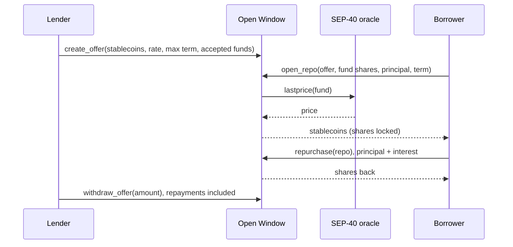

# Open Window

[](https://github.com/EricLtx/hackmeridian-2026/actions/workflows/ci.yml)
[](LICENSE)
[](https://developers.stellar.org/docs/build/smart-contracts)

An on-chain repo contract on Stellar. Holders of tokenized money market funds borrow stablecoins against their shares at any hour, for a fixed term and a fixed price, when the fund's redemption window is closed.

**Try it on testnet:** [ericltx.github.io/hackmeridian-2026](https://ericltx.github.io/hackmeridian-2026/), the guided view, the terminal view ([`?view=terminal`](https://ericltx.github.io/hackmeridian-2026/?view=terminal)) and the History page, in English, French and Spanish. Reading needs nothing; signing needs Freighter set to Testnet and an onboarded address (see [web/README.md](web/README.md#use-it-with-a-wallet)).

> **Status:** early development (October 2026). Version 4 (audit candidate rc4, tag `audit-v4-rc4`, interface frozen since 18 October 2026) is implemented, tested and reviewed internally: the full lifecycle, time-delayed governance, a backup price feed, deferred share delivery, lenders independent of the fund (an instance can be fixed to a single regulated lender), the custody safeguards (delayed governor handover, guardian and steward backups) and, as an option fixed at deployment, a trustee whose consent every upgrade needs; since rc4, a stored schema version with a governed `migrate`, a sentinel that can only pause and cancel, and a stablecoin registry that waits for the time delay after the first admission. The testnet instance was upgraded and migrated under governance on 18 October 2026; it serves three funds (one of them a classic Stellar asset held through the Stellar Asset Contract) and two euro stablecoins, with 210 host tests behind it and nineteen incident drills rehearsed against it. It runs on testnet; nothing is deployed on mainnet, and no external audit has been done yet. The critical path to any deployment that holds value is key custody: the governor, guardian and steward keys must sit with separate people on hardware devices, which the testnet demo does not do. The legal form of the transaction and the operator's status are being qualified with counsel. "Open Window" (French: *guichet ouvert*) is the working name; it replaced "Night Window" when the contract became an issuer-agnostic liquidity facility rather than a night-time counter for treasurers. The crate, the paths and the WASM file keep the original name `night-window`.

## Why

- **Tokenized money market funds settle once per business day.** Between two redemption windows, a holder who needs liquidity cannot sell. Over a weekend the wait is three days.
- **So holders keep a buffer of idle stablecoins** next to their fund shares, and that buffer earns nothing.
- **A repo closes the gap.** The holder locks shares, receives stablecoins in the same transaction, and gets the shares back at a price fixed in advance. Lenders earn short-term interest secured by fund shares. Lenders are independent of the fund: a regulated lender can run its own instance for its clients, and the fund issuer, as steward of its fund, decides which lenders may take its shares as collateral. The issuer never funds or guarantees the loans: under EU money market fund rules, support to a fund's liquidity by its sponsor is forbidden.

Two parties, a fixed term, a known price, and you get your shares back. Banks do this every night; Open Window does it on a public payment network, with offers deposited in advance by whoever wants to lend.

## How it works

| Step | Who | What happens |
|---|---|---|
| Offer | Lender | Deposits stablecoins with terms: rate, maximum term, accepted funds |
| Open | Borrower | Locks fund shares and receives stablecoins in the same transaction |
| Repurchase | Borrower | Repays principal plus interest and gets the shares back |
| Default | Lender | After maturity, seizes the shares |
| Withdraw | Lender | Takes back the stablecoins that were not lent |



## Design choices

- Fixed term of seven days at most by default and a fixed rate. Early repurchase is allowed; interest counts per started hour, one hour at least, and keeps running after maturity until repurchase or seizure.
- A haircut per fund caps the loan below the value of the shares.
- Fund shares and stablecoins are SEP-41 tokens. The share price comes from a SEP-40 NAV feed fixed at the fund's admission, crossed through a SEP-40 FX feed when the NAV is not in the loan currency.
- One ledger entry per fund, per offer and per repo, and no loop over all positions: the cost of every operation stays constant whatever the number of open repos.
- Issuer-agnostic: any permissioned fund share can be registered with its own oracle, haircut and allowlist. The contract address itself has to be allowlisted by the issuer, like any other holder, and so do lenders and borrowers. On testnet one instance runs two funds from two issuers (a USD T-bill share lent against in euro through an exchange-rate leg, a euro money-market share with no leg) and two euro stablecoins under one currency cap, admitted as data, with no contract change (`demo/README.md`, `--second-fund`).
- The NAV is checked against a corridor predicted from a reference, not against the previous reading: a money market fund share grows slowly and predictably, so a jump is a faulty price, not a market move. The reference follows the feed only along that model, never upward faster than a maximum yield; only the fund's steward can lower it, and only a two-key re-anchor can move it off the model, so a faulty feed cannot drag it.
- Roles: a governor (registry, risk envelope, upgrades), a guardian (pause new entries, cancel pending proposals, remove a backup feed, hand its role over), and a steward per fund, the issuer, who approves lenders and tunes its fund inside the envelope. A fund is admitted only when the governor and its steward sign the same call. Error codes and exported types are append-only. Two more roles exist: an optional trustee, fixed at deployment, whose signature every upgrade needs; and a sentinel, named by the guardian, that can pause and cancel but neither veto nor decide, so the monitoring host never holds the guardian key.
- Footprint: a repo is three transactions (offer, open, repurchase). The network's published estimates are about 0.2 Wh and 0.06 g CO2 per transaction (SDF and PwC, 2022; an independent 2021 measurement gives 0.222 Wh), so one repo costs well under one watt-hour. The design keeps it that way: constant cost per operation, no loops, minimal storage with TTL management, no polling.
- Controls in place: an allowlist of accepted stablecoins; caps per repo, per fund and per currency; an emergency pause that blocks new offers and new repos but never repurchase, withdrawal or seizure; a time delay with a guardian veto on upgrades, feed changes and every loosening; shares delivered later, never blocked, when an issuer freezes them. Details in [docs/security.md](docs/security.md).
- Keys: every role is an ordinary Stellar account, so the governor is a native multisig and any role can sit on hardware wallets that sign Soroban calls. Operations extend the contract instance but never its code entry, whose rent the operator pays.

## Contract interface

The contract lives in `contracts/night-window/src/` (`lib.rs` for the entry points; `math.rs`, `oracle.rs`, `storage.rs`, `token_io.rs`, `types.rs`, `error.rs`, `events.rs`); its tests in `src/test.rs`. Interface version 4, audit candidate rc2.

**Governance.** Upgrades, feed changes, re-anchoring, a new guardian, a longer maximum term, a looser risk envelope, looser fund limits and higher currency caps wait for a time delay (48 hours by default, settable until the first fund is admitted or the first offer is created, then only able to grow), can be cancelled during that window, and expire seven days after they fall due. Some changes stay immediate by design: tightening, `unpause`, the stablecoin registry, lender approvals, unfreezing a fund, the guardian handing its role over, and, for now, the governor handover (see the roadmap). Tightening is immediate. Anyone may apply a change once it is due: the signatures were given when it was proposed.

| Function | Who | What it does |
|---|---|---|
| `__constructor(admin)` | deployer | Sets the governor, who is also the first guardian, and the default risk envelope |
| `set_admin(new)`, `accept_admin()`, `cancel_admin()`, `veto_admin(caller)` | governor, then successor; guardian or trustee may veto | Two-step governor handover behind the time delay; the new governor drops the proposals the old one made alone, not those co-signed by a steward |
| `set_timelock_delay(secs)` | governor | Any value from 60 s to 30 days before the first admission, then only longer |
| `propose_upgrade(hash)`, `upgrade(hash)`, `cancel_upgrade(caller)` | governor **and** the trustee when one is named; guardian or trustee may cancel | Code change after the delay, exact hash only |
| `set_trustee(trustee)`, `hand_over_trustee(new)`, `trustee()`, `veto_forced_guardian_change(caller)` | governor **and** trustee, before the first admission / trustee **and** successor / governor or trustee | An optional independent party whose signature every upgrade and forced guardian change needs, and who can veto them and a governor handover. Fixed for the life of the instance (a lost trustee key means no upgrade ever, by design), can hold no other role, replaces only itself; a hand-over drops what the previous trustee co-signed |
| `set_max_term`, `set_envelope`, `set_currency_cap`, `set_guardian` (+ `apply_*`, `cancel_*`, `pending_*`) | governor | Tightening at once; loosening and a new guardian after the delay, cancellable by the guardian |
| `set_guardian_backup(backup)`, `hand_over_guardian(new)` / `force_guardian_change(new)` | governor **and** guardian / guardian / governor (**and** trustee) | The guardian can only hand its role to a backup both registered; the governor can replace it only after 30 days, without the guardian's veto but with the trustee's consent, and the trustee may veto |
| `set_sole_lender(lender)` | governor, before the first admission | Fixes the instance's only lender for good: a regulated lender running its own instance |
| `attest_lender(fund, lender, declaration)` | lender **and** steward | Records the hash of the lender's off-chain declaration (eligibility, independence from the fund); required before approval |
| `set_steward_backup(fund, backup)` (+ `apply_steward_backup_change`, `cancel_steward_backup_change`), `propose_steward_recovery` (+ apply, cancel) | steward **and** backup / governor **and** guardian | A lost steward key can be replaced only by the backup the issuer registered, after 30 days; any action by the steward cancels the recovery. A first backup is set at once; replacing it waits for the delay, and the governor may cancel the replacement (block, never choose) |
| `set_stablecoin(token, currency)` (+ `apply_stablecoin_change`, `cancel_stablecoin_change`, `pending_stablecoin_change`), `remove_stablecoin(token)` | governor; anyone applies; guardian or sentinel may cancel | Stablecoin registry: immediate before the first admission, a proposal behind the delay afterwards (S29); removal immediate |
| `set_sentinel(sentinel)`, `clear_sentinel(caller)`, `sentinel()` | guardian / guardian or governor | An automated key that may only pause and cancel proposals, never lift the pause, veto or hand over (S26); what a monitoring host holds instead of the guardian key |
| `schema_version()`, `migrate()` | anyone / governor **and** trustee | The stored layout's version; after an upgrade, `migrate` brings it to the code's version step by step; until then new offers and repos answer `SchemaOutdated`, exits never check (S29, S6) |
| `set_fund(fund, config)` (+ `apply_fund_change`, `cancel_fund_change`) | governor **and** steward | Two-key admission, immediate the first time; a replacement waits for the delay, keeps the price references, and needs the steward on record |
| `propose_reanchor(fund, expected_nav, expected_fx)` (+ apply, cancel) | governor **and** steward | The only way to move a fund's price reference off its model: the signers name the values, the contract checks today's feeds agree, and installs those values after the delay if the feeds still follow the model |
| `propose_fallback(fund, feed)` (+ apply, cancel, `remove_fallback`) | governor **and** steward; removal also by the guardian alone | A backup NAV feed that stands in for a stale primary and must agree with a fresh one |
| `remove_fund(fund)` | governor | Open repos keep their frozen terms |
| `pause(caller)` / `unpause()` | guardian or governor / governor | Stops new offers and new repos; never exits |
| `set_fund_limits` (+ apply, cancel), `approve_lender`, `freeze_fund`, `reset_reference`, `set_sponsor` | the fund's steward, never a lender itself | Tunes its own fund inside the envelope; loosening its limits waits for the delay. An approval records the steward that granted it: after a steward change, new offers and new loans wait for the new steward's approval, while positions opened before stay deliverable |
| `refresh_reference(fund)` | anyone | Moves the NAV reference along the model path |
| `quote(fund, shares, stablecoin)`, `fund_price(fund)`, `repo_due(repo)` | anyone | Read-only valuation, raw NAV, interest due now |
| `create_offer(lender, stablecoin, amount, rate_bps, max_term, funds)` | approved lender | Deposits stablecoins with fixed terms |
| `withdraw_offer(offer, amount)` | lender | Takes back what is not lent, including repaid principal and interest |
| `open_repo(borrower, offer, fund, shares, principal, term)` | borrower | Locks shares and receives stablecoins in one transaction |
| `repurchase(repo)` | borrower | Repays principal and interest, gets the shares back |
| `seize(repo, to)` | lender, from maturity | Sends the shares to an approved address |
| `release(repo)`, `redirect_release(repo, to)`, `pending_release(repo)` | anyone / beneficiary | Delivers shares the issuer's token refused at repurchase or seizure, once the issuer allows it |

How a price is checked before any loan: the NAV must be fresh, inside a corridor predicted from its reference (a slowly growing fund share cannot jump), agree with the backup feed when one is set, and, when the NAV is not in the loan currency, be crossed through an FX feed that has its own freshness and band, with an extra FX haircut. The decisions behind every check are recorded in [docs/security.md](docs/security.md), section 6.

## Roadmap

[docs/roadmap.md](docs/roadmap.md) maps each product claim to its evidence (test, demo scene, testnet transaction), then sets out the steps to a guarded launch with the exit criteria of each step. Progress so far:

- [x] Rust workspace, pinned toolchain, CI with security lints and dependency audit
- [x] Administration, upgrade path, fund registry, SEP-40 price lookup, tests
- [x] Security baseline with threat model, invariants and the framing decisions S1 to S29 (October 2026)
- [x] STRIDE threat model initiated with a first monitoring plan; CI green on GitHub (October 2026)
- [x] Specification of the repo lifecycle (states, functions, errors, tests)
- [x] Lifecycle: offers, including offers the issuer designates, open, repurchase, seize, withdraw, with property tests on the invariants
- [x] Roles: governor (two-step handover), guardian, one steward per fund; two-key fund admission
- [x] Model-based NAV corridor, cross price through an FX feed with its own band and haircut
- [x] Independent security review; every finding fixed or recorded, with a test per fix
- [x] Demo contracts: allowlisted fund share token (`fund-token`) and operator-fed SEP-40 feed (`nav-oracle`)
- [x] Monitoring plan implemented and rehearsed on testnet: every detector with a possible real trigger fired on one ([docs/incident-procedure.md](docs/incident-procedure.md))
- [x] Upgrade test with the real WASM, 200-repo load test at constant cost, Scout static analysis with every alert justified
- [x] Version 3 (October 2026): time delay on upgrades, feed changes and every loosening; guardian veto that the governor alone cannot remove inside a window; backup NAV feed; shares delivered later when the issuer blocks them, instead of a blocked exit
- [x] Native multisig governor with an outside co-signer, on testnet; key-compromise and issuer-freeze drills rehearsed ([docs/incident-procedure.md](docs/incident-procedure.md))
- [x] Three internal security reviews of version 3, every finding fixed with a test; audit package ready ([docs/audit-scope.md](docs/audit-scope.md))
- [x] Testnet deployment with test fund tokens and a test oracle: a scripted live demo in [demo/](demo/README.md), with a fallback FX feed
- [x] Minimal web interface with Freighter: market board, borrow, positions, repurchase, lend, withdraw, take the shares at maturity ([web/](web/README.md))
- [x] Two views of the web interface (19 October 2026): a guided page with a guide per party, the instance's terms read from the chain and a timeline per position; and a terminal view for desk users, keyboard-first, with an offer book, tickets that show every number and check before signing, a positions blotter, the funds and a tape of contract events ([web/README.md](web/README.md#terminal-view))
- [x] English, French and Spanish in both views and on the History page (20 October 2026): a switch in the header or `LANG FR` in the terminal, numbers and dates in each language's own form, inputs read in that form, and a check that fails the tests when a visible text lacks a translation ([web/README.md](web/README.md#languages))
- [x] Treasurer's return priced in the live demo with the contract's own interest rule
- [ ] Key custody, the critical path: governor signers on separate hardware devices with one outside the team, a guardian restricted to pause and cancel, issuer stewards held in multisig
- [x] Version 4 (October 2026): lenders independent of the fund (the issuer can never lend, attestation before approval, optional single-lender instance); custody safeguards found by the custody study (governor handover behind the delay with a guardian veto, guardian handover only to a registered backup, steward recovery only to the issuer's backup); two internal review passes, every finding fixed with a test
- [x] Audit candidate rc2 (October 2026): optional trustee whose signature every upgrade and forced guardian change needs; approvals bound to the steward that granted them; delayed replacement of a steward backup; property tests on the arithmetic; two internal review passes, every finding fixed with a test
- [x] Append-only event indexer with a hash chain anchored on chain, register and SFTR views, History page (17 October 2026)
- [x] Audit candidate rc4 (18 October 2026): FX band bounded by the FX haircut (S22); stablecoin registry behind the time delay after the first admission; sentinel role for the monitoring host; schema version with a governed `migrate`, tested against the rc2 WASM deployed on testnet; embedded spec trimmed to 76.9 % of the size cap, long-form text in [docs/interface-reference.md](docs/interface-reference.md); interface frozen at the tag `audit-v4-rc4`
- [x] Governed upgrade and migration executed on the testnet instance; sentinel named; nineteen drills rehearsed, thirteen detectors per fund ([demo/](demo/README.md))
- [x] Several funds and stablecoins as data: a euro money market share, a share held through the Stellar Asset Contract with the issuer's native flags (freeze handled live), two euro stablecoins under one currency cap (18 October 2026)
- [x] Operator kit: [docs/operations.md](docs/operations.md) and `npm run inventory`, the off-chain instance register
- [ ] OpenZeppelin detectors for Soroban (blocked on Windows; to run on Linux)
- [ ] Legal qualification of the transaction and of the operator, with counsel
- [ ] Third-party audit before any mainnet deployment, and a bug bounty sized to the value at stake

## Security

[docs/security.md](docs/security.md) holds the threat model, the contract invariants, the vulnerability classes mapped to this contract, the controls already in place and the decisions taken for the specification (price freshness and a model-based NAV corridor per fund, MiCA-only stablecoin allowlist, emergency pause limited to new entries, multisig administrator with a time delay, launch caps, lender's reserve), and maps the contractual requirements an EU-regulated issuer must pass on to its ICT providers under DORA (Regulation (EU) 2022/2554, Article 30). [docs/threat-model-stride.md](docs/threat-model-stride.md) is the STRIDE threat model with its monitoring plan, rehearsed on testnet; [docs/incident-procedure.md](docs/incident-procedure.md) says who acts on each alert; [docs/audit-scope.md](docs/audit-scope.md) is the package for external auditors. [SECURITY.md](SECURITY.md) says how to report a vulnerability.

The enforced part of the baseline:

- `rust-toolchain.toml` pins Rust 1.98.1 with the `wasm32v1-none` target, `rustfmt` and `clippy`.
- Workspace lints deny `unsafe_code`, unchecked arithmetic (`clippy::arithmetic_side_effects`), `unwrap`, `expect`, `panic!` and slice indexing in contract code. Tests opt out explicitly.
- Overflow checks stay on in release and test profiles.
- CI runs `cargo fmt --check`, `stellar contract build`, `cargo clippy --all-targets -D warnings`, `cargo test` (the upgrade test uploads the built WASM), the web interface's build and unit tests, and a RustSec advisory check on `Cargo.lock`. Every third-party action is pinned to a commit SHA and kept current by Dependabot. `make lint`, `make audit` and `make scout` in `contracts/night-window/` reproduce the checks locally.
- Maintenance rule: the workspace stays within the two latest major versions of `soroban-sdk`, the ones that receive security fixes, and is rebuilt and retested at every Stellar protocol upgrade. Deadlines are stored as timestamps, never derived from storage TTLs, so changes in ledger timing do not affect them.

## Repository layout

```
.
├── contracts/
│   ├── night-window/        # Open Window, the repo contract, and its host-side tests (src/test.rs)
│   ├── fund-token/          # demo: SEP-41 share token restricted to an issuer allowlist
│   └── nav-oracle/          # demo: SEP-40 feed an operator publishes a NAV to
├── demo/                    # testnet demo runner, wallet onboarding, monitoring, key-ceremony tooling (Node.js)
├── indexer/                 # append-only event journal under a hash chain; register and SFTR views
├── web/                     # web interface (Vite, plain JavaScript, Freighter): guided view, terminal view, history page; English, French, Spanish
├── docs/
│   ├── security.md          # security baseline: threat model, invariants, framing decisions S1-S29
│   ├── threat-model-stride.md # STRIDE threat model and monitoring plan
│   ├── incident-procedure.md # incident procedure and monitoring rehearsal
│   ├── faq.md               # questions and answers for five audiences
│   ├── roadmap.md           # from MVP to a product in operation
│   ├── stellar-platform.md  # overview of the Stellar platform
│   └── claude-tooling.md    # AI tooling: plugins, skills, MCP
├── .github/
│   ├── workflows/ci.yml     # format, lint, test, WASM build and size budget, cargo-deny, RustSec audit, link check
│   └── dependabot.yml       # weekly bumps of pinned actions and crates
├── .claude/                 # Stellar plugin shared through the repo; hook refusing to stage private folders
├── .mcp.json                # Raven MCP server (Stellar docs and live data)
├── AGENTS.md / CLAUDE.md    # instructions for AI agents
├── rust-toolchain.toml      # pinned Rust version, target and components
├── SECURITY.md              # how to report a vulnerability
└── Cargo.toml               # Rust workspace (soroban-sdk 28) and security lints
```

The market study, the business proposal and third-party reference material are working documents kept outside the public repository (`private/` and `references/`, both git-ignored).

## Build and test

### 1. Tools

| Tool | Windows | macOS / Linux |
|---|---|---|
| Rust via rustup | [rustup.rs](https://rustup.rs) | `curl https://sh.rustup.rs -sSf \| sh` |
| Pinned toolchain and Wasm target | installed automatically by rustup from `rust-toolchain.toml` on the first `cargo` command | same |
| Stellar CLI | `winget install --id Stellar.StellarCLI` | `brew install stellar-cli` |

Check with `stellar --version`. The workspace is tested with 28.1.0.

### 2. Compile and test

```sh
stellar contract build                          # → target/wasm32v1-none/release/night_window.wasm
cargo clippy --all-targets -- -D warnings       # security lints
cargo test                                      # unit tests, run off-chain (the upgrade test needs the WASM)
```

### 3. Deploy to testnet

```sh
# Identity funded automatically by Friendbot
stellar keys generate alice --network testnet --fund

# The constructor takes the administrator address
stellar contract deploy \
  --wasm target/wasm32v1-none/release/night_window.wasm \
  --source-account alice --network testnet --alias night_window \
  -- --admin alice

stellar contract invoke --id night_window --source-account alice --network testnet \
  -- version
# 3
```

The deployed contract can be inspected on [stellar.expert/explorer/testnet](https://stellar.expert/explorer/testnet) or in [Stellar Lab](https://lab.stellar.org). `stellar contract invoke --id night_window -- -h` prints the generated command line for every function.

### 4. Run the live demo

[demo/README.md](demo/README.md) deploys the three contracts on testnet with a test euro stablecoin, then runs the scenes live: opening a repo, the refusals (loan too large, faulty NAV, pause), repurchase, seizure at maturity, and a comparison with the redemption route at four moments of the week.

```sh
cd demo && npm install
npm run setup     # at least one hour before: the seizure scene needs a matured repo
npm run demo
```

### 5. Use the web interface

[web/README.md](web/README.md) serves the interface against the testnet deployment written by `npm run setup`. The market board needs no wallet. To borrow or lend, connect Freighter on testnet, add the tEUR trustline in the page, then let the operator onboard the address.

```sh
cd web && npm install && npm run dev
cd demo && npm run onboard -- G...YOUR_ADDRESS     # --role=lender for a lender
```

The History page lists every repo and event since the deployment from the export of [indexer/](indexer/README.md), an append-only journal of the contract's events kept under a hash chain beyond the RPC's retention of about seven days:

```sh
cd indexer && npm install
npm run index                       # read new events behind a persistent cursor
npm run verify                      # recompute the hash chain
npm run export -- --json --web      # feed web/public/history.json
```

## Documentation

- [docs/faq.md](docs/faq.md): questions and answers for newcomers, users, the Stellar ecosystem, engineers and security reviewers.
- [docs/roadmap.md](docs/roadmap.md): what the MVP proves, and the steps to a product in operation.

- [docs/architecture.md](docs/architecture.md): the map: context, deployable units, components, repo lifecycle, price controls, governance automaton, storage, several funds as data, governed upgrade, operations, build chain.
- [docs/security.md](docs/security.md): security baseline, threat model and invariants of the contract.
- [docs/threat-model-stride.md](docs/threat-model-stride.md): STRIDE threat model and monitoring plan.
- [docs/incident-procedure.md](docs/incident-procedure.md): incident procedure, roles, action per alert and the monitoring rehearsal.
- [docs/operations.md](docs/operations.md): running an instance as its operator: roles and keys, deployment order, admission checklist, daily tasks, governed upgrades with the pre-upgrade inventory, the instance register.
- [docs/audit-scope.md](docs/audit-scope.md): audit package: scope, reproducible build, trust model, invariants, reviews done, where to look hardest.
- [docs/interface-reference.md](docs/interface-reference.md): interface reference: the long-form description of every entry point, type and error, kept out of the WASM.
- [docs/stellar-platform.md](docs/stellar-platform.md): overview of the Stellar platform.
- [docs/claude-tooling.md](docs/claude-tooling.md): AI tooling.
- [AGENTS.md](AGENTS.md): build, test and security rules for contributors and AI agents.

## Contributing

Issues and pull requests are welcome. Before opening a pull request, run `make lint` and `make test` in `contracts/night-window/`, or the same commands CI runs. Keep error codes and exported types append-only, and read [docs/security.md](docs/security.md) before touching the contract.

## Building with AI

The repo is preconfigured for [Claude Code](https://claude.com/claude-code). Open the folder and accept the prompts:

- **`stellar-dev` plugin**, the official Stellar skill: contracts, dApps, assets, data, SEP/CAP standards, agentic payments.
- **`stellar-raven` MCP server**: search in the Stellar docs and queries on live ecosystem data.

Details and alternatives are in [docs/claude-tooling.md](docs/claude-tooling.md).

## License

[Apache License 2.0](LICENSE). Copyright and trademark notice in [NOTICE](NOTICE).
