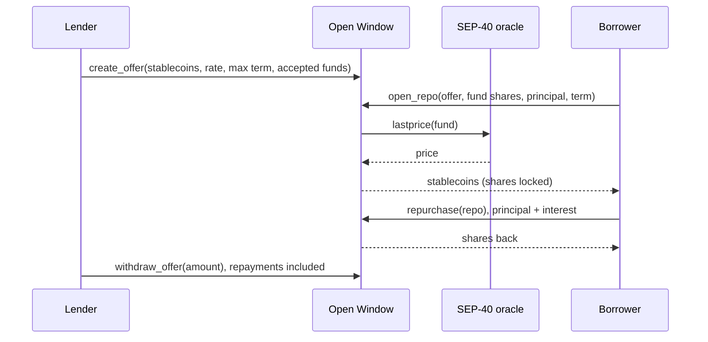

# Open Window

[](https://github.com/EricLtx/hackmeridian-2026/actions/workflows/ci.yml)
[](LICENSE)
[](https://developers.stellar.org/docs/build/smart-contracts)

An on-chain repo contract on Stellar. Holders of tokenized money market funds borrow stablecoins against their shares at any hour, for a fixed term and a fixed price, when the fund's redemption window is closed.

> **Status:** early development (October 2026). The full lifecycle is implemented and tested (offers, repos, repurchase, seizure, roles, price checks), and was reviewed for security; nothing is deployed on mainnet. "Open Window" (French: *guichet ouvert*) is the working name; it replaced "Night Window" when the contract became an issuer-agnostic liquidity facility rather than a night-time counter for treasurers. The crate, the paths and the WASM file keep the original name `night-window`.

## Why

- **Tokenized money market funds settle once per business day.** Between two redemption windows, a holder who needs liquidity cannot sell. Over a weekend the wait is three days.
- **So holders keep a buffer of idle stablecoins** next to their fund shares, and that buffer earns nothing.
- **A repo closes the gap.** The holder locks shares, receives stablecoins in the same transaction, and gets the shares back at a price fixed in advance. Lenders earn short-term interest secured by fund shares. Offers can come from the market, or from the fund issuer itself when it wants to back the liquidity of its own shares without building a dedicated facility.

Two parties, a fixed term, a known price, and you get your shares back. Banks do this every night; Open Window does it on a public payment network, with offers deposited in advance by whoever wants to lend.

## How it works

| Step | Who | What happens |
|---|---|---|
| Offer | Lender | Deposits stablecoins with terms: rate, maximum term, accepted funds |
| Open | Borrower | Locks fund shares and receives stablecoins in the same transaction |
| Repurchase | Borrower | Repays principal plus interest and gets the shares back |
| Default | Lender | After maturity, seizes the shares |
| Withdraw | Lender | Takes back the stablecoins that were not lent |



## Design choices

- Fixed term of seven days at most by default and a fixed rate. Early repurchase is allowed; interest counts per started hour, one hour at least, and keeps running after maturity until repurchase or seizure.
- A haircut per fund caps the loan below the value of the shares.
- Fund shares and stablecoins are SEP-41 tokens. The share price comes from a SEP-40 NAV feed fixed at the fund's admission, crossed through a SEP-40 FX feed when the NAV is not in the loan currency.
- One ledger entry per fund, per offer and per repo, and no loop over all positions: the cost of every operation stays constant whatever the number of open repos.
- Issuer-agnostic: any permissioned fund share can be registered with its own oracle, haircut and allowlist. The contract address itself has to be allowlisted by the issuer, like any other holder, and so do lenders and borrowers.
- The NAV is checked against a corridor predicted from a reference, not against the previous reading: a money market fund share grows slowly and predictably, so a jump is a faulty price, not a market move. The reference never falls and rises at most at a maximum yield, so a faulty feed cannot drag it.
- Three roles: a governor (registry, risk envelope, upgrades), a guardian (pause only), and a steward per fund, the issuer, who approves lenders and tunes its fund inside the envelope. A fund is admitted only when the governor and its steward sign the same call. Error codes and exported types are append-only.
- Footprint: a repo is three transactions (offer, open, repurchase). The network's published estimates are about 0.2 Wh and 0.06 g CO2 per transaction (SDF and PwC, 2022; an independent 2021 measurement gives 0.222 Wh), so one repo costs well under one watt-hour. The design keeps it that way: constant cost per operation, no loops, minimal storage with TTL management, no polling.
- Controls in place: an allowlist of accepted stablecoins, caps per repo, per fund and per currency, and an emergency pause that blocks new offers and new repos but never repurchase, withdrawal or seizure. Planned before any real deposit: a multisig governor with a time delay on upgrades and oracle changes. Details in [docs/securite.md](docs/securite.md).

## Contract interface

The contract lives in `contracts/night-window/src/` (`lib.rs` for the entry points; `math.rs`, `oracle.rs`, `storage.rs`, `token_io.rs`, `types.rs`, `error.rs`, `events.rs`); its tests in `src/test.rs`. Interface version 2.

| Function | Who | What it does |
|---|---|---|
| `__constructor(admin)` | deployer | Sets the governor, who is also the first guardian, and the default risk envelope |
| `set_admin(new)`, `accept_admin()` | governor, then successor | Two-step governor handover |
| `upgrade(wasm_hash)`, `set_max_term(secs)`, `set_envelope(envelope)`, `set_guardian(addr)` | governor | Code, term ceiling (1 hour to 30 days), risk envelope, guardian |
| `set_stablecoin(token, currency)`, `remove_stablecoin(token)`, `set_currency_cap(currency, cap)` | governor | Stablecoin registry and per-currency caps (unset means no lending) |
| `set_fund(fund, config)` | governor **and** steward | Two-key admission: checks the envelope and the oracles' currency, reads decimals, anchors the NAV (and FX) reference |
| `remove_fund(fund)` | governor | Open repos keep their frozen terms |
| `pause(caller)` / `unpause()` | guardian or governor / governor | Stops new offers and new repos; never exits |
| `set_fund_limits(fund, haircut, per_repo, total)`, `approve_lender(fund, lender, bool)`, `freeze_fund(fund, bool)`, `reset_reference(fund)`, `set_sponsor(offer, fund, bool)` | the fund's steward | Tunes its own fund inside the envelope |
| `refresh_reference(fund)` | anyone | Moves the NAV reference along the model path |
| `quote(fund, shares, stablecoin)`, `fund_price(fund)`, `repo_due(repo)` | anyone | Read-only valuation, raw NAV, interest due now |
| `create_offer(lender, stablecoin, amount, rate_bps, max_term, funds)` | approved lender | Deposits stablecoins with fixed terms |
| `withdraw_offer(offer, amount)` | lender | Takes back what is not lent, including repaid principal and interest |
| `open_repo(borrower, offer, fund, shares, principal, term)` | borrower | Locks shares and receives stablecoins in one transaction |
| `repurchase(repo)` | borrower | Repays principal and interest, gets the shares back |
| `seize(repo, to)` | lender, from maturity | Sends the shares to an approved address |

How a price is checked before any loan: the NAV must be fresh, inside a corridor predicted from its reference (a slowly growing fund share cannot jump), and, when the NAV is not in the loan currency, crossed through an FX feed that has its own freshness and band, with an extra FX haircut. The decisions behind every check are recorded in [docs/securite.md](docs/securite.md), section 6.

## Roadmap

[docs/roadmap.md](docs/roadmap.md) maps each product claim to its evidence (test, demo scene, testnet transaction), then sets out the steps to a guarded launch with the exit criteria of each step. Progress so far:

- [x] Rust workspace, pinned toolchain, CI with security lints and dependency audit
- [x] Administration, upgrade path, fund registry, SEP-40 price lookup, tests
- [x] Security baseline with threat model, invariants and the framing decisions S1 to S19 (October 2026)
- [x] STRIDE threat model initiated with a first monitoring plan; CI green on GitHub (October 2026)
- [x] Specification of the repo lifecycle (states, functions, errors, tests)
- [x] Lifecycle: offers including sponsor offers, open, repurchase, seize, withdraw, with property tests on the invariants
- [x] Roles: governor (two-step handover), guardian, one steward per fund; two-key fund admission
- [x] Model-based NAV corridor, cross price through an FX feed with its own band and haircut
- [x] Independent security review; every finding fixed or recorded, with a test per fix
- [x] Demo contracts: allowlisted fund share token (`fund-token`) and operator-fed SEP-40 feed (`nav-oracle`)
- [ ] Monitoring plan rehearsed on testnet with at least one real trigger
- [ ] Multisig administrator and time delay on upgrades and oracle changes (the emergency pause is in place)
- [x] Testnet deployment with test fund tokens and a test oracle: a scripted live demo in [demo/](demo/README.md), with a fallback FX feed
- [ ] Minimal web interface
- [ ] Third-party audit before any mainnet deployment

## Security

[docs/securite.md](docs/securite.md) (French) holds the threat model, the contract invariants, the vulnerability classes mapped to this contract, the controls already in place and the decisions taken for the specification (price freshness and a model-based NAV corridor per fund, MiCA-only stablecoin allowlist, emergency pause limited to new entries, multisig administrator with a time delay, launch caps, first-loss buffer), and maps the contractual requirements an EU-regulated issuer must pass on to its ICT providers under DORA (Regulation (EU) 2022/2554, Article 30). [docs/modele-menace-stride.md](docs/modele-menace-stride.md) (French) is the STRIDE threat model with a first monitoring plan. [SECURITY.md](SECURITY.md) says how to report a vulnerability.

The enforced part of the baseline:

- `rust-toolchain.toml` pins Rust 1.98.1 with the `wasm32v1-none` target, `rustfmt` and `clippy`.
- Workspace lints deny `unsafe_code`, unchecked arithmetic (`clippy::arithmetic_side_effects`), `unwrap`, `expect`, `panic!` and slice indexing in contract code. Tests opt out explicitly.
- Overflow checks stay on in release and test profiles.
- CI runs `cargo fmt --check`, `cargo clippy --all-targets -D warnings`, `cargo test`, `stellar contract build` and a RustSec advisory check on `Cargo.lock`. Every third-party action is pinned to a commit SHA and kept current by Dependabot. `make lint`, `make audit` and `make scout` in `contracts/night-window/` reproduce the checks locally.
- Maintenance rule: the workspace stays within the two latest major versions of `soroban-sdk`, the ones that receive security fixes, and is rebuilt and retested at every Stellar protocol upgrade. Deadlines are stored as timestamps, never derived from storage TTLs, so changes in ledger timing do not affect them.

## Repository layout

```
.
├── contracts/
│   ├── night-window/        # Open Window, the repo contract, and its host-side tests (src/test.rs)
│   ├── fund-token/          # demo: SEP-41 share token restricted to an issuer allowlist
│   └── nav-oracle/          # demo: SEP-40 feed an operator publishes a NAV to
├── demo/                    # testnet demo runner (Node.js, @stellar/stellar-sdk)
├── docs/
│   ├── securite.md          # security baseline: threat model, invariants, framing decisions S1-S19 (French)
│   ├── modele-menace-stride.md # STRIDE threat model and first monitoring plan (French)
│   ├── stellar-platform.md  # overview of the Stellar platform (French)
│   └── claude-tooling.md    # AI tooling: plugins, skills, MCP (French)
├── .github/
│   ├── workflows/ci.yml     # format, lint, test, WASM build, RustSec audit
│   └── dependabot.yml       # weekly bumps of pinned actions and crates
├── .claude/settings.json    # Stellar plugin shared through the repo
├── .mcp.json                # Raven MCP server (Stellar docs and live data)
├── AGENTS.md / CLAUDE.md    # instructions for AI agents
├── rust-toolchain.toml      # pinned Rust version, target and components
├── SECURITY.md              # how to report a vulnerability
└── Cargo.toml               # Rust workspace (soroban-sdk 28) and security lints
```

The market study, the business proposal and third-party reference material are working documents kept outside the public repository (`private/` and `references/`, both git-ignored).

## Build and test

### 1. Tools

| Tool | Windows | macOS / Linux |
|---|---|---|
| Rust via rustup | [rustup.rs](https://rustup.rs) | `curl https://sh.rustup.rs -sSf \| sh` |
| Pinned toolchain and Wasm target | installed automatically by rustup from `rust-toolchain.toml` on the first `cargo` command | same |
| Stellar CLI | `winget install --id Stellar.StellarCLI` | `brew install stellar-cli` |

Check with `stellar --version`. The workspace is tested with 28.1.0.

### 2. Compile and test

```sh
stellar contract build                          # → target/wasm32v1-none/release/night_window.wasm
cargo clippy --all-targets -- -D warnings       # security lints
cargo test                                      # unit tests, run off-chain (the upgrade test needs the WASM)
```

### 3. Deploy to testnet

```sh
# Identity funded automatically by Friendbot
stellar keys generate alice --network testnet --fund

# The constructor takes the administrator address
stellar contract deploy \
  --wasm target/wasm32v1-none/release/night_window.wasm \
  --source-account alice --network testnet --alias night_window \
  -- --admin alice

stellar contract invoke --id night_window --source-account alice --network testnet \
  -- version
# 2
```

The deployed contract can be inspected on [stellar.expert/explorer/testnet](https://stellar.expert/explorer/testnet) or in [Stellar Lab](https://lab.stellar.org). `stellar contract invoke --id night_window -- -h` prints the generated command line for every function.

### 4. Run the live demo

[demo/README.md](demo/README.md) deploys the three contracts on testnet with a test euro stablecoin, then runs the scenes live: opening a repo, the refusals (loan too large, faulty NAV, pause), repurchase, seizure at maturity, and a comparison with the redemption route at four moments of the week.

```sh
cd demo && npm install
npm run setup     # at least one hour before: the seizure scene needs a matured repo
npm run demo
```

## Documentation

- [docs/faq.md](docs/faq.md): questions and answers for newcomers, users, the Stellar ecosystem, engineers and security reviewers.
- [docs/roadmap.md](docs/roadmap.md): what the MVP proves, and the steps to a product in operation.

- [docs/securite.md](docs/securite.md): security baseline, threat model and invariants of the contract (French).
- [docs/modele-menace-stride.md](docs/modele-menace-stride.md): STRIDE threat model and monitoring plan (French).
- [docs/stellar-platform.md](docs/stellar-platform.md): overview of the Stellar platform (French).
- [docs/claude-tooling.md](docs/claude-tooling.md): AI tooling (French).
- [AGENTS.md](AGENTS.md): build, test and security rules for contributors and AI agents.

## Contributing

Issues and pull requests are welcome. Before opening a pull request, run `make lint` and `make test` in `contracts/night-window/`, or the same commands CI runs. Keep error codes and exported types append-only, and read [docs/securite.md](docs/securite.md) before touching the contract.

## Building with AI

The repo is preconfigured for [Claude Code](https://claude.com/claude-code). Open the folder and accept the prompts:

- **`stellar-dev` plugin**, the official Stellar skill: contracts, dApps, assets, data, SEP/CAP standards, agentic payments.
- **`stellar-raven` MCP server**: search in the Stellar docs and queries on live ecosystem data.

Details and alternatives are in [docs/claude-tooling.md](docs/claude-tooling.md).

## License

[Apache License 2.0](LICENSE). Copyright and trademark notice in [NOTICE](NOTICE).
