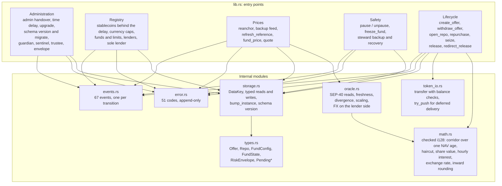
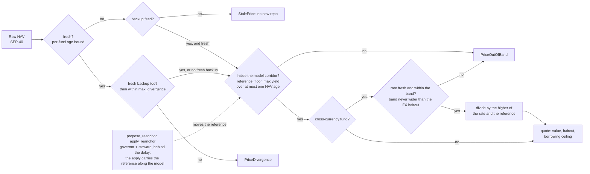
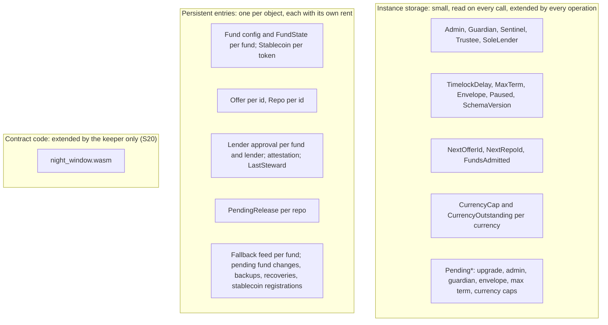
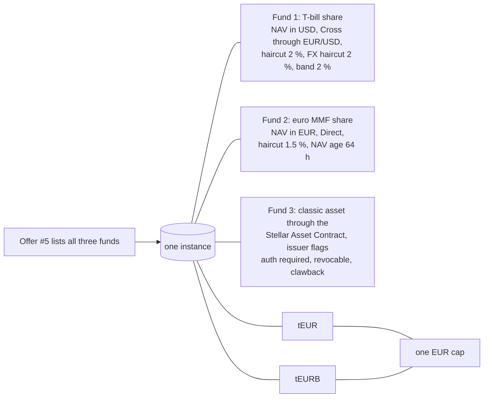
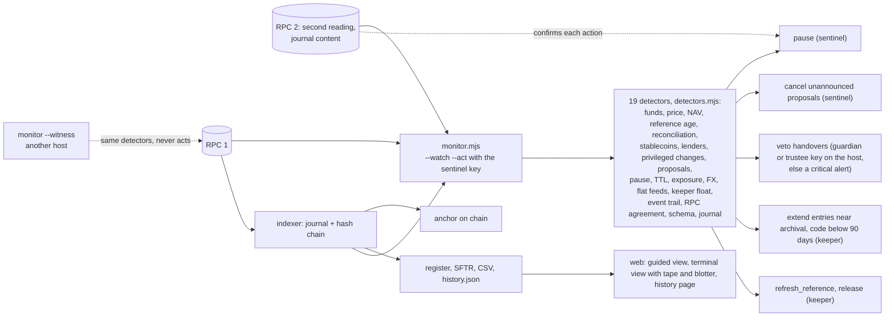

# Architecture of Open Window

What the system is made of, how a repo flows through it, how it is governed, priced, stored, upgraded and operated. State of 22 October 2026: contract version 4; the testnet instance runs rc5 (tag `audit-v4-rc5`, commit `0de6482`), installed by a governed upgrade on 22 October 2026 without migration; rc5 fixes the findings of the security pass of 20 October 2026 and of its adversarial review the same day. Diagrams are Mermaid; GitHub renders them. The authoritative descriptions are [security.md](security.md) (decisions S1 to S34), [interface-reference.md](interface-reference.md) (every entry point) and [operations.md](operations.md) (running an instance); this page is the map.

An embedded-systems reading helps: the contract is firmware, the Stellar ledger is a shared RAM and flash paid by the byte and by the day, SEP-40 feeds are sensors, SEP-41 tokens are peripherals driven over a bus, and the time delay is a watchdog that lets a second person stop a bad command before it takes effect.

## 1. Context: who talks to what


Three facts shape everything else. The issuer never lends against its own fund (S24, Art. 35 of the EU money market fund regulation). An instance can be fixed to a single lender that also operates it (S23): the lender is the governor, the issuer is the steward, the project supplies the software. Exits are never blocked: repurchase, withdrawal of unlent funds, seizure at maturity and the delivery of held-back shares work during a pause, during a proposal and whatever the schema version (S6).

## 2. Deployable units

| Unit | Technology | Role | Where it runs |
|---|---|---|---|
| `night_window.wasm` | Rust `no_std`, soroban-sdk 28, target `wasm32v1-none`, a 64 KiB stack (S34); about 100 KB, under the 120 KB CI budget (exact size and hash of the rc5 candidate in [audit-scope.md](audit-scope.md)) | the product: fund and stablecoin registry, offers, repos, delayed governance, price controls, schema version | the ledger; one instance per lender-operator |
| `fund_token.wasm` | Rust, SEP-41 with allowlist, freeze and clawback | stand-in for a permissioned fund share, tests and demo only | testnet |
| `nav_oracle.wasm` | Rust, SEP-40 fed by an operator | stand-in for a NAV feed and a backup feed | testnet |
| Stellar Asset Contract | Stellar's own token contract for classic assets | the third demo fund's share: a token this repository did not write, with the issuer's native flags | testnet |
| `demo/` | Node 20, `@stellar/stellar-sdk` 17 | `setup` (deployment, roles, admissions, offers), `run` (scenes), `upgrade` (governed upgrade and migration), `inventory`, `monitor` (its detectors in `detectors.mjs`), `keys` (ceremonies), `measure`, `fxlog`, `onboard`; every write checked before signing (its own call's authorizations only, its footprint, a fee cap); offline tests (`npm test`) | the operator's host |
| `indexer/` | Node 20 | event journal beyond the RPC's retention, SHA-256 hash chain, on-chain anchor, CSV, register and SFTR exports, `history.json` for the web | the operator's host |
| `web/` | Vite, plain JavaScript, Freighter | two views of one state: a guided page (guide per party with live terms, market board, borrow, positions with timelines, lend) and a terminal view for desk users (command line, offer book, tickets, blotter, funds, tape); a history page; English, French and Spanish; two public RPCs, with failover on an error or on staleness, and every write confirmed on the second; every value read from the chain checked before display, a content security policy, the fee of the transaction to sign checked before the wallet is asked, no run inside another site's frame | static files, published on GitHub Pages by `pages.yml` |
| CI | GitHub Actions | `cargo fmt --check`, `stellar contract build`, size budget, `clippy -D warnings`, `cargo test`; the contract's suite against a WASM with an 8 KiB stack (`wasm-canary`); web tests and build after an install without scripts and an advisory gate; the demo's and indexer's tests (`tooling`); `cargo deny`, RustSec audit, link check; Pages deployment of `web/` | GitHub |

## 3. The contract's components

`lib.rs` holds the 113 public entry points; the modules under it are stateless and tested on their own. Workspace lints deny `unwrap`, `panic!`, unchecked arithmetic and direct indexing in contract code.



Every privileged function loads its role from storage and calls `require_auth` on it; every address whose authority a function consumes signs that function. Deadlines are stored timestamps compared to the ledger clock, never inferred from a time to live.

## 4. A repo, from offer to delivery

```mermaid
stateDiagram-v2
  [*] --> Offer: create_offer (lender approved by the steward; funds listed, rate, term ceiling)
  Offer --> Offer: withdraw_offer (unlent part, any time, even paused)
  Offer --> Open: open_repo (borrower; price checked; caps checked; shares in, stablecoins out, one transaction)
  Open --> Repurchased: repurchase (any time; principal + interest per started hour, back into the offer)
  Open --> Defaulted: seize (lender, from maturity; shares to the lender or another address the issuer approved)
  Repurchased --> [*]: shares delivered
  Defaulted --> [*]: shares delivered
  Repurchased --> ReleasePending: the share token refused the transfer (freeze, allowlist, clawback)
  Defaulted --> ReleasePending: idem, or the lender is no longer approved (rc5)
  ReleasePending --> [*]: release (anyone retries) or redirect_release (beneficiary, to an approved holder after a seizure)
```



The one-transaction opening:

```mermaid
sequenceDiagram
  autonumber
  participant B as Borrower
  participant OW as Open Window
  participant NAV as NAV feed
  participant FX as Exchange-rate feed
  participant FT as Fund shares
  participant EU as Stablecoin
  B->>OW: open_repo(borrower, offer_id, fund, shares, amount, term)
  OW->>OW: require_auth(borrower); not paused; schema current; fund admitted and not frozen; offer alive; term within ceilings
  OW->>NAV: lastprice(fund)
  OW->>FX: lastprice(currency) when the NAV is not in the loan currency
  OW->>OW: freshness, NAV corridor, FX band, NAV divided by the higher of the rate and the reference (backup feed if the primary is stale)
  OW->>OW: ceiling = value x (1 - haircut) rounded down; caps per repo, per fund, per currency
  OW->>OW: sole lender; lender approved by the steward in place
  OW->>FT: transfer(borrower -> contract, shares)
  OW->>EU: transfer(contract -> borrower, amount)
  OW->>OW: Repo{opened_at, maturity, rate}; offer debited; instance rent extended
  OW-->>B: repo_id; events repo_opened, repo_valued (rc5), reference_updated when the reference moves
```

Measured on testnet: about 6.9 million instructions, 27 entries read and 8 written, 0.81 XLM including the 120-day rent of the new entries; a cycle (open + repurchase) costs 0.836 XLM, about 0.06 % of a weekend's interest on one million. The footprint is constant whatever the number of open repos (load test, 200 repos).

## 5. Prices: the control chain



The reference follows the feed only along the model path, never faster than the maximum yield even on a faulty reading published at every ledger; only admission and the two-key re-anchor move it elsewhere (S2, S21). The risk envelope (S27) bounds each per-fund setting on its own. Since rc5 the corridor grows over at most the NAV age bound after the reference, and each fund's haircut must cover it from its bottom to its top, two floors plus one NAV age of growth, at admission, replacement and limits (S30); the FX band stays within the FX haircut and the rate divides the NAV only on the lender's side of the band (S22); feeds publish with 6 to 18 decimals, every bound rounds inward and the cross price is exact whatever the rate (S32). The re-anchor is the exception to the window: its apply counts the growth since the proposal over the real elapsed time, which the proposal's life bounds, and installs the NAV read then, carried along the model path from the proposed NAV and never below it, with the signed FX rate (S21); since that one unsigned reading can lift the reference by the growth over the proposal's life, a re-anchor is refused unless the haircut covers two floors plus the growth over the delay, the seven-day grace and two NAV ages (S30). A reference nobody moves fails closed once an honest NAV outgrows its corridor: the keeper steps it with `refresh_reference` (section 10).

A backup feed's reading goes through the same corridor. Since rc5 a backup is never the primary feed itself, and it is installed only against a fresh primary it agrees with (S1); once installed, it stands in alone when the primary is stale, checked by its own age and the corridor: that is what a backup is for.

## 6. Governance: one automaton for every change

```mermaid
stateDiagram-v2
  [*] --> None
  None --> Proposed: propose (governor; plus the trustee for an upgrade or a forced guardian change)
  Proposed --> None: cancel (governor, guardian or sentinel)
  Proposed --> None: veto (guardian, or trustee for a forced guardian change)
  Proposed --> Applicable: ledger time >= eta
  Applicable --> Applied: apply (anyone, until eta + 7 days)
  Applicable --> None: expired after eta + 7 days
  Applied --> [*]
  note right of Proposed
    eta = now + timelock_delay, stored. Demo 5 minutes, production 48 hours or more.
    Tightening applies at once; loosening waits.
  end note
```



The automaton covers upgrades, the governor handover, the guardian (and its 30-day forced replacement), the term ceiling, the envelope, fund replacements and limit loosenings, currency caps, stablecoin registrations after the first admission (S29; since rc5 applied by the governor in office, not by anyone), the backup feed, the re-anchor, the steward backup and the steward recovery. Before the first admission (bootstrap) settings apply at once, and the sole lender and the trustee can only be fixed then; at the first admission the contract cancels a governor handover and, since rc5, an upgrade proposed during bootstrap.

Roles and their reach:

| Role | May | May not |
|---|---|---|
| Governor | propose everything above, apply a stablecoin registration (rc5), lift a pause, admit and remove funds with the steward, `migrate` with the trustee | skip a delay; lend; move a reference alone |
| Guardian | pause entries, cancel any proposal, veto a handover or a forced change, name the sentinel, hand over to its registered backup only | lift a pause; block an exit |
| Sentinel | pause, cancel | veto, lift a pause, decide anything; hold or be proposed for any other role (rc5, both ways) |
| Trustee | co-sign upgrades and forced guardian changes, replace itself | anything else; it is checked independent of every other role, proposed roles included (rc5) |
| Steward (issuer) | admit its fund with the governor, approve and revoke lenders, tune limits inside the envelope, lower the reference, freeze, register its backup | lend against its fund, in any way (S24) |
| Lender | create and withdraw offers, seize at maturity, even after a revocation, its shares then waiting for an approval (rc5) | lend on a fund whose steward did not approve it |

## 7. Storage and rent



Persistent entries are extended at every write and, for the entries an exit reads (lender approvals, attestations, steward backups), at every read; the monitor alerts when an open entry nears archival. The schema version (S29) names the stored layout: after an upgrade, `migrate` (governor and trustee) transforms it; entries refuse to open while the layout is behind the code, exits never check.

Cost per call, measured on the testnet instance from the validators' own metrics of executed rc4 transactions (20 October 2026): the heaviest opening (a cross-currency fund, three price reads) used 6,645,361 instructions, 1.66 % of the 400 million a transaction may use, and about 1.9 ms of execution; an opening on a share held through the Stellar Asset Contract used 3,611,825. Every path is bounded by constants (at most eight funds per offer, no loop over positions), so the cost does not grow with usage, and the time a user waits is the ledger close (about five seconds) and the RPC, not the contract. Fees are dominated by rent: an opening was charged about 0.74 to 0.76 XLM of resource fees, most of it for the new repo entry, which receives a lifetime of 120 days at once.

The rc5 candidate lowers the fixed part of every call: each call of the contract allocates its whole linear memory before any work, and a 64 KiB stack instead of the linker's default 1 MiB starts the module with 2 pages instead of 17, which saves 122,880 instructions and 983,040 bytes of memory per call (S34, `contracts/night-window/build.rs`). The bench of the release WASM (`test_perf.rs`) checks every user-facing call against a budget of 12 million instructions, 12 entries written, 8,192 bytes written and 2,048 bytes of events. Its figures are the host's model: a transaction declares the RPC's padded simulation of the network path, which costs 17 to 20 % more than the bench before the padding. The testnet figures above are rc4's; rc5's follow its governed upgrade.

## 8. Several funds and stablecoins as data



Admitting a fund or a stablecoin is a transaction, not a code change; each fund carries its own feed, operator, haircut, ages and caps; several tokens of one currency share one cap. The testnet instance has run this configuration since 18 October 2026.

## 9. Upgrade and migration, governed

```mermaid
sequenceDiagram
  autonumber
  participant Op as Operator
  participant G as Governor
  participant Tr as Trustee
  participant OW as Open Window
  participant M as Monitor
  Op->>OW: upload new WASM
  G->>OW: propose_upgrade(hash) co-signed by Tr
  Op->>M: announce(hash)  (an unannounced proposal is treated as an attack and cancelled)
  Note over OW: time delay; guardian or sentinel may cancel
  Op->>OW: upgrade(hash) after eta
  Op->>OW: read the executable the ledger holds, compare
  G->>OW: migrate() co-signed by Tr, when schema_version < SCHEMA_VERSION
  Op->>M: move the code baseline
```

Before an upgrade that tightens an admission rule, `npm run inventory` lists the funds the new rule would refuse, so their replacements can be proposed in the same delay window (18 October 2026 lesson); for rc5 it checks the haircut against the corridor, the feeds' decimals and the stablecoins' decimals. An upgrade is proposed after the first admission: one proposed before is cancelled at it (rc5). The script takes the expected hash (`npm run upgrade -- --expect=<sha256>`, the WASM built at the tag in a clean shell), refuses to run while `NIGHT_WINDOW_STACK_SIZE` or `CARGO_TARGET_DIR` is set, checks that the built stack is 65,536 bytes, announces before it proposes, applies only a pending hash equal to the built and expected one, and keeps the new code alive to 91 days (rc5, after the adversarial review). The testnet instance runs the tag `audit-v4-rc4`; the rc5 candidate, reviewed adversarially on 20 October 2026, becomes `audit-v4-rc5` and then goes through this sequence, after a `refresh_reference` on each fund and with no `migrate` since its stored layout is rc4's. Any change to `contracts/` means a new tag and a new rehearsal.

## 10. Operations: monitoring, journal, interface



Nineteen drills, one per detector with a real trigger, were rehearsed on the testnet instance on 18 October 2026, against rc4, and replayed against rc5 on 22 October 2026 after its governed upgrade ([incident-procedure.md](incident-procedure.md), section 5). The detectors rc5 adds (reference age, flat feeds, stablecoin authorization, revoked lenders, proposals read from state, unreadable funds, the journal checked by content) have offline tests in `demo/test/` and no drill yet. With two endpoints, the default, every action waits for the second endpoint's own reading of the facts it rests on; reads simulate from the null account, so the host holds no governor key.

The web interface sits on its own trust boundary (F7 in [threat-model-stride.md](threat-model-stride.md)). It reads the chain through public RPCs, SDF's first and Gateway.fm's when the first fails, times out twice within 30 s, keeps refusing with HTTP 429 or, since rc5, falls more than 10 ledgers and 60 s behind by its own close time, each call with its own time limit; the endpoint left rests 60 s (up to 10 min when it fails again soon after), the page sends at most 20 calls a second to one endpoint with at most 6 in flight, and it returns to SDF's once that one is level and rested. Every value it decodes is checked before it reaches the page; the content security policy of its pages limits connections to those endpoints and Friendbot. Since rc5 the fee of the assembled transaction the wallet will sign is checked (25 XLM at most, equal to the simulation's estimate), a write shows as confirmed only once the second endpoint sees it (a write only one endpoint saw is said so, in amber), the page refuses to run inside another site's frame, and the footer names the RPC providers, which see the visitor's IP address. The published deployment file lists only keyless public endpoints, and the page accepts only one for the test network.

## 11. Build and audit chain

```mermaid
flowchart LR
  SRC[contracts/night-window/src] --> FMT[cargo fmt --check]
  FMT --> BLD[stellar contract build]
  BLD --> SZ{size budget<br/>122,880 bytes}
  SZ --> CL[clippy -D warnings]
  CL --> TST[cargo test: contract host tests<br/>incl. the rc2 WASM upgraded and migrated,<br/>the real-time budget]
  TST --> CAN[wasm-canary: the suite against<br/>a WASM with an 8 KiB stack]
  CAN --> DENY[cargo deny]
  DENY --> AUD[RustSec audit]
  AUD --> HASH[reproducible WASM hash<br/>= executable on the ledger]
  HASH --> TAG[tag audit-v4-rc5 on testnet<br/>since 22 October 2026]
  TAG --> EXT[external audit<br/>through the Audit Bank: to come]
```



## 12. What the map does not show

- Key custody: the testnet roles sit on one machine; the target (hardware signers, separate people, a managed key store for the sentinel and the keeper) is the critical path to any deployment that holds value ([security.md](security.md), section 6.4).
- Legal qualification of the transaction and of the operator: being qualified with counsel.
- External audit and bug bounty: before mainnet, with the other steps of [security.md](security.md), section 7 ("Before mainnet").
- A fund issued by another organisation: the third fund proves the token code is not ours, not that the issuer is.
