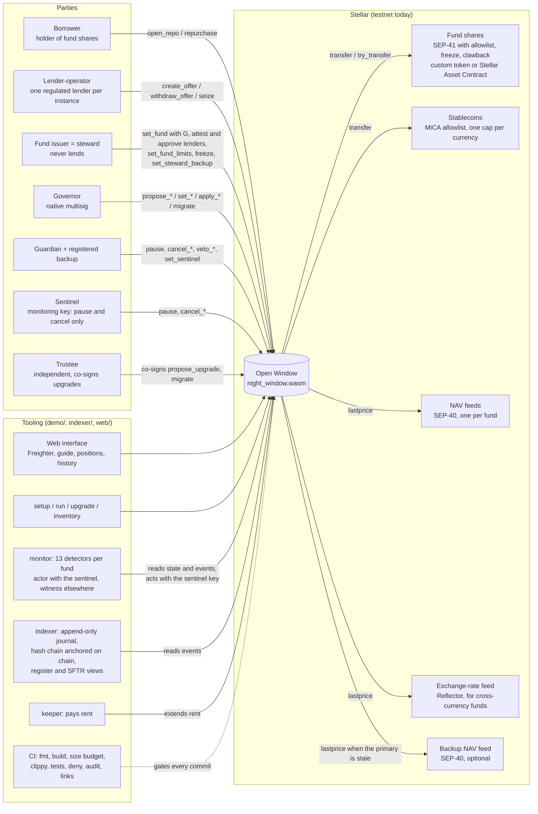
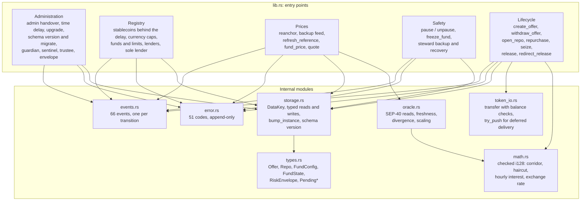
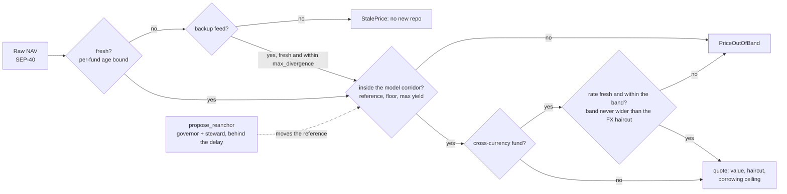
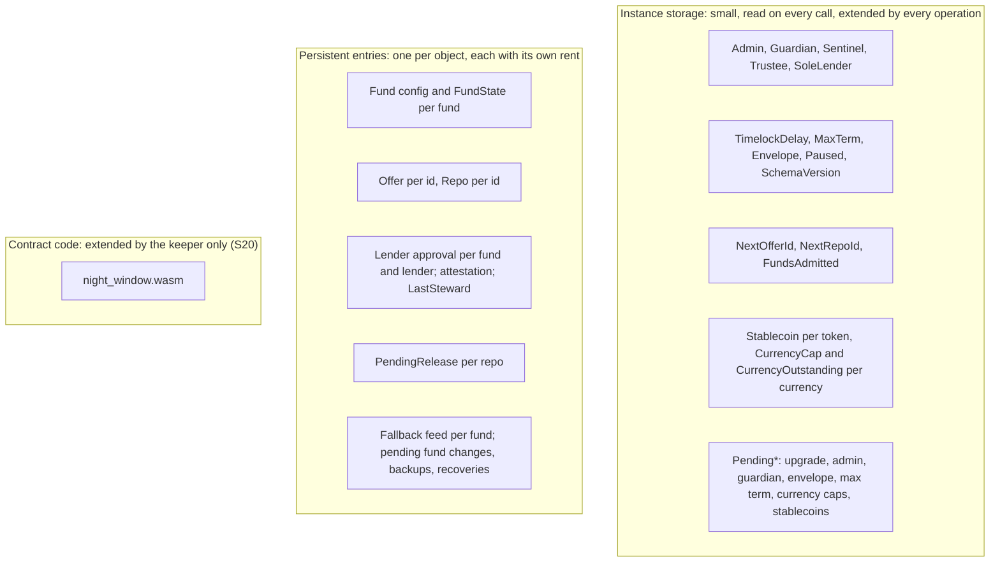
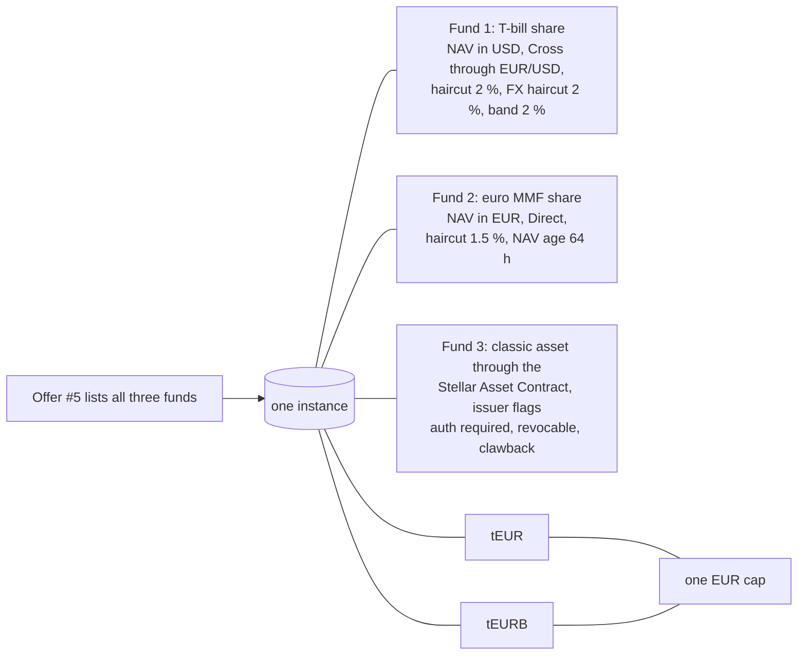
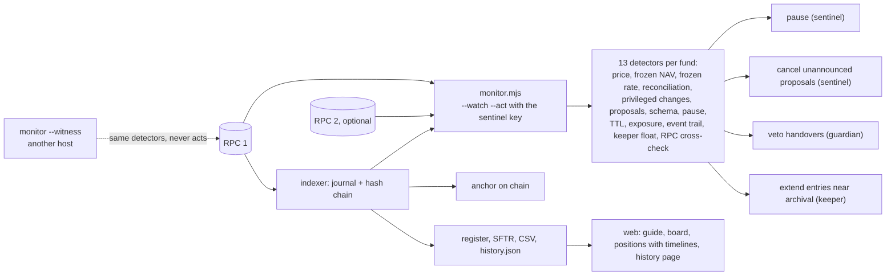
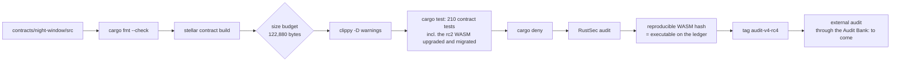

# Architecture of Open Window

What the system is made of, how a repo flows through it, how it is governed, priced, stored, upgraded and operated. State of 19 October 2026: contract version 4, audit candidate rc4 (tag `audit-v4-rc4`), deployed, upgraded and migrated on Stellar testnet. Diagrams are Mermaid; GitHub renders them. The authoritative descriptions are [security.md](security.md) (decisions S1 to S29), [interface-reference.md](interface-reference.md) (every entry point) and [operations.md](operations.md) (running an instance); this page is the map.

An embedded-systems reading helps: the contract is firmware, the Stellar ledger is a shared RAM and flash paid by the byte and by the day, SEP-40 feeds are sensors, SEP-41 tokens are peripherals driven over a bus, and the time delay is a watchdog that lets a second person stop a bad command before it takes effect.

## 1. Context: who talks to what



Three facts shape everything else. The issuer never lends against its own fund (S24, Art. 35 of the EU money market fund regulation). An instance can be fixed to a single lender that also operates it (S23): the lender is the governor, the issuer is the steward, the project supplies the software. Exits are never blocked: repurchase, withdrawal of unlent funds, seizure at maturity and the delivery of held-back shares work during a pause, during a proposal and whatever the schema version (S6).

## 2. Deployable units

| Unit | Technology | Role | Where it runs |
|---|---|---|---|
| `night_window.wasm` | Rust `no_std`, soroban-sdk 28, target `wasm32v1-none`; 100,757 bytes (76.9 % of the network cap) | the product: fund and stablecoin registry, offers, repos, delayed governance, price controls, schema version | the ledger; one instance per lender-operator |
| `fund_token.wasm` | Rust, SEP-41 with allowlist, freeze and clawback | stand-in for a permissioned fund share, tests and demo only | testnet |
| `nav_oracle.wasm` | Rust, SEP-40 fed by an operator | stand-in for a NAV feed and a backup feed | testnet |
| Stellar Asset Contract | Stellar's own token contract for classic assets | the third demo fund's share: a token this repository did not write, with the issuer's native flags | testnet |
| `demo/` | Node 20, `@stellar/stellar-sdk` 17 | `setup` (deployment, roles, admissions, offers), `run` (scenes), `upgrade` (governed upgrade and migration), `inventory`, `monitor`, `keys` (ceremonies), `measure`, `fxlog`, `onboard` | the operator's host |
| `indexer/` | Node 20 | event journal beyond the RPC's retention, SHA-256 hash chain, on-chain anchor, CSV, register and SFTR exports, `history.json` for the web | the operator's host |
| `web/` | Vite, plain JavaScript, Freighter | guide per party with live terms, market board, borrow, positions with timelines, lend, history page | static files |
| CI | GitHub Actions | `cargo fmt --check`, `stellar contract build`, size budget, `clippy -D warnings`, `cargo test`, web tests and build, `cargo deny`, RustSec audit, link check | GitHub |

## 3. The contract's components

`lib.rs` holds the 113 public entry points; the modules under it are stateless and tested on their own. Workspace lints deny `unwrap`, `panic!`, unchecked arithmetic and direct indexing in contract code.



Every privileged function loads its role from storage and calls `require_auth` on it; every address whose authority a function consumes signs that function. Deadlines are stored timestamps compared to the ledger clock, never inferred from a time to live.

## 4. A repo, from offer to delivery

```mermaid
stateDiagram-v2
  [*] --> Offer: create_offer (lender approved by the steward; funds listed, rate, term ceiling)
  Offer --> Offer: withdraw_offer (unlent part, any time, even paused)
  Offer --> Open: open_repo (borrower; price checked; caps checked; shares in, stablecoins out, one transaction)
  Open --> Repurchased: repurchase (any time; principal + interest per started hour, back into the offer)
  Open --> Defaulted: seize (lender, after maturity; shares to an address the issuer approved)
  Repurchased --> [*]: shares delivered
  Defaulted --> [*]: shares delivered
  Repurchased --> ReleasePending: the share token refused the transfer (freeze, allowlist, clawback)
  Defaulted --> ReleasePending: idem
  ReleasePending --> [*]: release (anyone retries) or redirect_release (beneficiary)
```



The one-transaction opening:

```mermaid
sequenceDiagram
  autonumber
  participant B as Borrower
  participant OW as Open Window
  participant NAV as NAV feed
  participant FX as Exchange-rate feed
  participant FT as Fund shares
  participant EU as Stablecoin
  B->>OW: open_repo(borrower, offer_id, fund, shares, amount, term)
  OW->>OW: require_auth(borrower); not paused; schema current; fund admitted and not frozen; offer alive; term within ceilings
  OW->>NAV: lastprice(fund)
  OW->>FX: lastprice(currency) when the NAV is not in the loan currency
  OW->>OW: freshness, NAV corridor, FX band (backup feed if the primary is stale)
  OW->>OW: ceiling = value x (1 - haircut) rounded down; caps per repo, per fund, per currency
  OW->>OW: sole lender; lender approved by the steward in place
  OW->>FT: transfer(borrower -> contract, shares)
  OW->>EU: transfer(contract -> borrower, amount)
  OW->>OW: Repo{opened_at, maturity, rate}; offer debited; instance rent extended
  OW-->>B: repo_id, event repo_opened
```

Measured on testnet: about 6.9 million instructions, 27 entries read and 8 written, 0.81 XLM including the 120-day rent of the new entries; a cycle (open + repurchase) costs 0.836 XLM, about 0.06 % of a weekend's interest on one million. The footprint is constant whatever the number of open repos (load test, 200 repos).

## 5. Prices: the control chain



The reference follows the feed only along the model path and never ratchets up on a faulty reading; only admission and the two-key re-anchor move it elsewhere (S2, S21). The risk envelope (S27) bounds every per-fund setting so that the corridor's maximum drift over the NAV age bound stays below the haircut, and the FX band stays within the FX haircut (S22).

## 6. Governance: one automaton for every change

```mermaid
stateDiagram-v2
  [*] --> None
  None --> Proposed: propose (governor; plus the trustee for an upgrade or a forced guardian change)
  Proposed --> None: cancel (governor, guardian or sentinel)
  Proposed --> None: veto (guardian, or trustee for a forced guardian change)
  Proposed --> Applicable: ledger time >= eta
  Applicable --> Applied: apply (anyone, until eta + 7 days)
  Applicable --> None: expired after eta + 7 days
  Applied --> [*]
  note right of Proposed
    eta = now + timelock_delay, stored. Demo 5 minutes, production 48 hours or more.
    Tightening applies at once; loosening waits.
  end note
```



The automaton covers upgrades, the governor handover, the guardian (and its 30-day forced replacement), the term ceiling, the envelope, fund replacements and limit loosenings, currency caps, stablecoin registrations after the first admission (S29), the backup feed, the re-anchor, the steward backup and the steward recovery. Before the first admission (bootstrap) settings apply at once, and the sole lender and the trustee can only be fixed then.

Roles and their reach:

| Role | May | May not |
|---|---|---|
| Governor | propose everything above, lift a pause, admit and remove funds with the steward, `migrate` with the trustee | skip a delay; lend; move a reference alone |
| Guardian | pause entries, cancel any proposal, veto a handover or a forced change, name the sentinel, hand over to its registered backup only | lift a pause; block an exit |
| Sentinel | pause, cancel | veto, lift a pause, decide anything |
| Trustee | co-sign upgrades and forced guardian changes, replace itself | anything else; it is checked independent of every other role |
| Steward (issuer) | admit its fund with the governor, approve and revoke lenders, tune limits inside the envelope, lower the reference, freeze, register its backup | lend against its fund, in any way (S24) |
| Lender | create and withdraw offers, seize at maturity | lend on a fund whose steward did not approve it |

## 7. Storage and rent



Persistent entries are extended at every write and, for the entries an exit reads (lender approvals, attestations, steward backups), at every read; the monitor alerts when an open entry nears archival. The schema version (S29) names the stored layout: after an upgrade, `migrate` (governor and trustee) transforms it; entries refuse to open while the layout is behind the code, exits never check.

## 8. Several funds and stablecoins as data



Admitting a fund or a stablecoin is a transaction, not a code change; each fund carries its own feed, operator, haircut, ages and caps; several tokens of one currency share one cap. The testnet instance has run this configuration since 18 October 2026.

## 9. Upgrade and migration, governed

```mermaid
sequenceDiagram
  autonumber
  participant Op as Operator
  participant G as Governor
  participant Tr as Trustee
  participant OW as Open Window
  participant M as Monitor
  Op->>OW: upload new WASM
  G->>OW: propose_upgrade(hash) co-signed by Tr
  Op->>M: announce(hash)  (an unannounced proposal is treated as an attack and cancelled)
  Note over OW: time delay; guardian or sentinel may cancel
  Op->>OW: upgrade(hash) after eta
  Op->>OW: read the executable the ledger holds, compare
  G->>OW: migrate() co-signed by Tr, when schema_version < SCHEMA_VERSION
  Op->>M: move the code baseline
```

Before an upgrade that tightens an admission rule, `npm run inventory` lists the funds the new rule would refuse, so their replacements can be proposed in the same delay window (18 October 2026 lesson). The tag of the audited code is `audit-v4-rc4`; any change to `contracts/` means a new tag and a new rehearsal.

## 10. Operations: monitoring, journal, interface



Nineteen drills, one per detector with a real trigger, were rehearsed on the testnet instance on 18 October 2026 ([incident-procedure.md](incident-procedure.md), section 5).

## 11. Build and audit chain



## 12. What the map does not show

- Key custody: the testnet roles sit on one machine; the target (hardware signers, separate people, a managed key store for the sentinel and the keeper) is the critical path to any deployment that holds value ([security.md](security.md), section 6.4).
- Legal qualification of the transaction and of the operator: being qualified with counsel.
- External audit and bug bounty: after the Stellar Community Fund application.
- A fund issued by another organisation: the third fund proves the token code is not ours, not that the issuer is.
